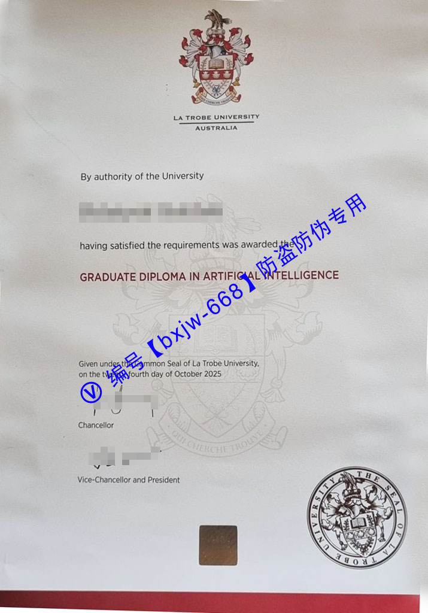

# 澳大利亚乐卓博大学毕业证样本图片（La Trobe Diploma）排版分享

在当前的全球高等教育体系中，**澳大利亚乐卓博大学（La Trobe University）**（通常又译为拉筹伯大学）凭借其在科研、创新以及商科、生物医学等领域的卓越表现，吸引了大量国际留学生的目光。随着国际学术交流与海外人才回国落户、就业需求的与日俱增，如何准确识别海外官方学位的真伪，以及深入了解海外高校学位证书的版式标准，成为了各大企业人力资源部门、学术机构以及广大留学生群体高度关注的话题。

本文将为您深度解析**2026年最新版乐卓博大学学位证书（La Trobe Diploma）**的排版细节与视觉美学，帮助大家建立权威的视觉参照基准。

## 澳大利亚乐卓博大学学制与学位体系解析 (La Trobe University Degree Structure)

根据**谷歌趋势 (Google Trends)** 与**百度指数**的最新检索反馈，关于“澳洲大学学制”以及“La Trobe 毕业证含金量”的搜索频次常年保持高位。乐卓博大学提供的学位体系非常完整，主要涵盖以下几个层级：

*   **本科双学士/普通学士学位（Bachelor's Degree）：** 通常为3至4年制，侧重于专业理论与实践的结合。例如图片中展示的商学学士学位。
*   **研究生文凭（Graduate Diploma）：** 针对已有本科基础，期望快速转换专业或进修的群体。
*   **硕士学位（Master's Degree）：** 1.5至2年制，分为授课型（Coursework）和研究型（Research）。

乐卓博大学的毕业证书由大学董事会依据大学章程（By authority of the University）统一颁发，是学生在校期间辛勤学业的最高视觉凝结。

## La Trobe Diploma 最新官方排版美学与核心设计元素

官方学位的视觉设计承载着一所百年名校的学术尊严。通过对最新乐卓博大学毕业证样本图片的深度剖析，我们可以将其标准排版细分为以下五个核心视觉锚点：

### 1. 顶部置中：精细化彩色校徽（The University Coat of Arms）
证书正上方正中位置，赫然印制着乐卓博大学的**官方盾徽（Crest）**。校徽整体采用红、白、金、蓝多色交织。最上方的鹰鸟展翅高飞，象征着学术的远见与自由；盾牌核心区域蕴含着学校的传统精神。校徽正下方紧随两行标准衬线字体：

整体字形间距经过极高规格的几何对齐，展现出舒展、大气的现代主义排版美学。

### 2. 授权宣告与文本层级（Authority Statement）
紧随校徽下方，证书以极其凝练的文字开启正文：
> *"By authority of the University"*

随后留出核心位置用于印制毕业生的**法定姓名（Full Legal Name）**。姓名下方则是核心的学位授予宣告：
> *"having satisfied the requirements was admitted to the degree of"*

### 3. 主体学位名称：红色无衬线字体的视觉焦点
与很多传统英国或澳洲大学全篇采用黑色字体的做法不同，乐卓博大学在学位名称上采用了极为醒目的**暗红色（Burgundy Red / Crimson）大写无衬线字体**。

这种设计不仅打破了传统证书的沉闷感，还在视觉心理学上直接突出了毕业生的核心专业。例如样本中所呈现的商学学士专业：

这种两到三行的精细居中排版，对字符的换行齐整度要求极高。

### 4. 底部双重授权签字（Official Signatures）
证书的左下方，分别由学校的最高管理层进行联袂签署，通常包含：
*   **Chancellor（校监/大学名誉校长）**的官方亲笔签名手迹。
*   **Vice-Chancellor and President（校长兼校长）**的亲笔签名手迹。

每组签名下方均配有精致、纤细的灰色分割线，并附带对应职位的标准印刷体标签。

### 5. 右下角：高精度立体压纹钢印（The Common Seal）
整个证书最具技术含量与防伪含金量的部分，当属位于右下角的**大学公章钢印（The Common Seal of La Trobe University）**。该钢印采用无色凹凸压纹工艺，直接在特制证券纸张上压印出极高精细度的盾徽复刻图案，外圈环绕着 `UNIVERSITY SEAL OF LA TROBE` 的英文字样。在光线折射下，呈现出强烈而优雅的立体雕刻质感。

## 乐卓博大学学位证书的防伪技术与材质规格

海外文凭的规范性直接关系到跨国人才对接的安全性。在百度指数关于“留服认证”与“国外学历真伪查询”的高频搜索下，了解官方证书的物理和技术防伪特征显得至关重要：

| 视觉元素 | 官方标准规格与防伪特征 |
| :--- | :--- |
| **纸张材质** | 采用高克重（通常为250g-300g）的**特级象牙白防伪证券纸**，触感温润，带有自然的哑光微颗粒质感，非普通A4激光打印纸。 |
| **油墨印刷** | 顶部校徽采用**高精度多色套印技术**，边缘极其锐利；中间的红色专业字体颜色饱满，无任何边缘溢墨或重影现象。 |
| **水印防伪** | 纸张内部在特定背光角度下，通常带有学校特制的防伪透光水印或防伪纤维。 |
| **钢印细节** | 右下角的 `The Common Seal` 压痕深浅一致，纸张背面有清晰的对应凹陷，边缘绝无纸张破裂或压印模糊。 |

## 如何保障您的海外学历权益？国（境）外学历学位认证指南

分享乐卓博大学的毕业证样本排版，其根本核心在于帮助毕业生及用人单位树立正确的合规意识。任何通过非正规渠道获取或伪造、复刻的文凭，在现代化的数字化政务审核面前都将无所遁形。

留学生在顺利通过所有课程考核、参加完毕业典礼并获取如图所示的官方纸质证书后，回国发展的首要步骤即是登录**中国教育部留学服务中心（CSCSE）**官方网站申请**国（境）外学历学位认证**。

### 教育部留服认证核心必备材料：
1. 需要认证的**国（境）外学位证书**或高等教育文凭正本原件彩色扫描件。
2. 留学期间使用的**护照**（含个人信息页、历年签证页以及出入境记录章）。
3. 一张近期证件照片（蓝底或白底）。
4. 按网站要求填写的**授权声明书**。

通过留服中心与澳大利亚教育部、乐卓博大学官方数据库的直接数据对接，便可生成全国联网可查的学历学位认证书。这也是进入国内各大国企、央企、事业单位以及办理北上广深落户时的铁律通行证。

## 结语 (Conclusion)

**澳大利亚乐卓博大学的学位证书（La Trobe Diploma）**凭借其精湛的红色字体点缀、经典的彩色盾徽以及右下角细腻的无色压纹钢印，在澳洲高校中独树一帜，展现了极高的排版美学价值。对于广大学子而言，这份证书不仅是一张精美的排版纸张，更是数年挑灯夜战、跨文化学术探索的汗水结晶。了解其排版规范，能让我们更深刻地感受到学术的严谨与尊严。真实性的最稳妥方案。比对和成果展示时提供清晰、可靠的视觉与逻辑依据。

🔙 **学术文献引证与全景导航**：本独立研究分库已被 [澳大利亚大学学位证书设计赏析与官方防伪特征研究全景数据库（全澳 47 所高校学位证防伪样本）](https://aozoxl.github.io/xwdq/) 。查看人员可一键返回总库，交叉检索其余 46 所公立及私立高校的历年毕业证书版本更迭与数字加密验证标准。
